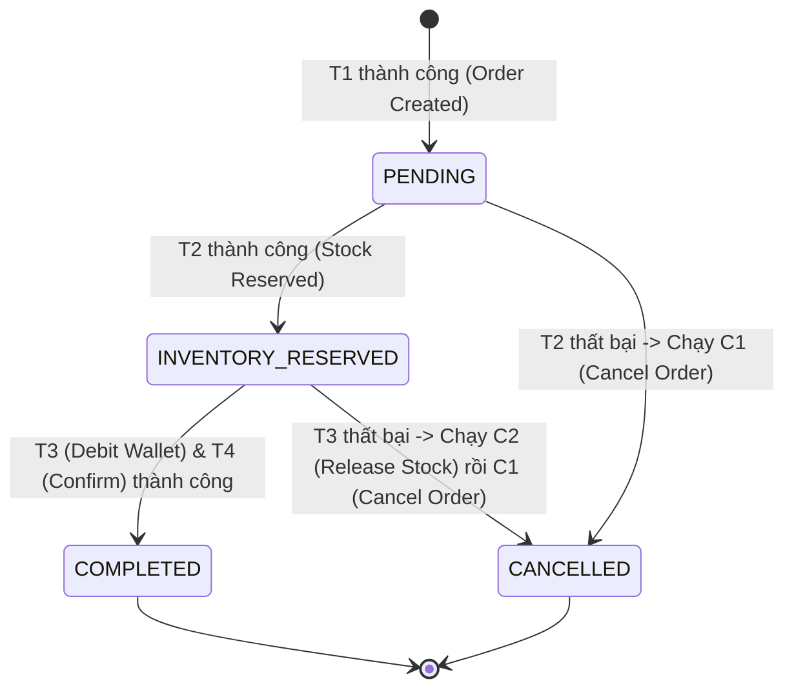

# 6. Hướng dẫn Implement SAGA vào Project (Từ State Diagram đến Code)

Tài liệu này hướng dẫn **thứ tự tư duy và implement code** để xây dựng hệ thống SAGA Orchestration cho 3 microservices (`order-service`, `inventory-service`, `payment-service`) theo đúng 4 bước:

1. **Thiết kế State Diagram** (Hiểu luồng trạng thái chuẩn trước khi code)
2. **Hiện thực hóa State & Log tại `common-dto` và `SagaInstance`** (Biến State Diagram thành cấu trúc dữ liệu)
3. **Xây dựng các cặp $T_k - C_k$ tại 3 Services nghiệp vụ** (Forward Action + Compensating Action)
4. **Lập trình `SagaOrchestratorService` & nguyên lý chạy Stack LIFO** (Điều phối luồng tiến & lùi)

---

## Bước 1: Thiết kế State Diagram (Hiểu luồng chạy đúng)

Về bản chất, một **Saga Orchestrator là một State Machine (Máy trạng thái hữu hạn)**. Trước khi viết bất kỳ dòng code gọi API nào, ta cần xác định rõ một đơn hàng sẽ đi qua những **Node trạng thái (States)** nào và những **Bước chuyển (Transitions)** nào.



### Ý nghĩa của từng Node trên State Diagram:
- **`PENDING` (Node 1 - Semantic Lock ở Order):** Đơn hàng vừa được tạo ở Bước $T_1$, đang khóa tạm chờ giữ kho và thanh toán.
- **`INVENTORY_RESERVED` (Node 2 - Semantic Lock ở Inventory):** Bước $T_2$ đã giữ hàng thành công vào `reservedStock`, đang chờ Bước $T_3$ trừ tiền.
- **`COMPLETED` (Node kết thúc thành công):** Bước $T_3$ (trừ tiền) và Bước $T_4$ (xác nhận kho + chốt đơn) đều thành công.
- **`CANCELLED` (Node kết thúc sau khi đã bù trừ):** Có lỗi xảy ra ở $T_2$, $T_3$ hoặc $T_4$, hệ thống đã chạy ngược các bước bù trừ $C_k$ để trả lại dữ liệu về trạng thái an toàn.

---

## Bước 2: Hiện thực hóa State Diagram thành Code (`common-dto` & `SagaInstance`)

Sau khi có State Diagram, bước tiếp theo là biến các **Nodes (Trạng thái)** và **Edges (Bước chuyển / Log)** trên sơ đồ thành code trong module `common-dto` và model `SagaInstance`.

### 2.1. Biểu diễn các Node trạng thái bằng `OrderStatus`
File: `common-dto/.../OrderStatus.java`

```java
public enum OrderStatus {
    PENDING,             // Node 1: Đơn mới tạo (Semantic Lock)
    INVENTORY_RESERVED,  // Node 2: Đã giữ hàng trong kho
    COMPLETED,           // Node đích (Happy Path)
    CANCELLED            // Node đích sau khi đã chạy Compensation (Rollback)
}
```

### 2.2. Biểu diễn các Bước chuyển (Transitions) bằng `SagaStepStatus` & `SagaStepLog`
File: `common-dto/.../SagaStepStatus.java` & `SagaStepLog.java`

Mỗi khi đơn hàng di chuyển từ Node này sang Node khác trên State Diagram (gọi REST sang 1 service), hệ thống cần ghi lại bước chuyển đó đang ở trạng thái nào:
- `PENDING`: Đang chờ xử lý.
- `SUCCESS`: Bước tiến $T_k$ thực thi thành công.
- `FAILED`: Bước tiến $T_k$ bị lỗi (kích hoạt rẽ nhánh bù trừ).
- `COMPENSATING`: Đang bắt đầu chạy ngược bước bù trừ $C_k$ (hoặc đang retry bù trừ).
- `COMPENSATED`: Bước bù trừ $C_k$ đã hoàn tất.

### 2.3. Hợp đồng giao tiếp Request/Response giữa các Service
Các DTO (`InventoryRequest`, `PaymentRequest`) đều bắt buộc chứa **`orderId`**:
- Giúp liên kết mọi thao tác ở 3 service rời rạc về cùng một phiên Saga.
- Đóng vai trò là **Idempotency Key** để các service ghi nhận *Operation Log* (chống trừ kho / trừ tiền 2 lần khi mạng retry).

### 2.4. `SagaInstance` — Hồ sơ theo dõi 1 phiên giao dịch trên State Diagram
File: `saga-orchestrator/.../model/SagaInstance.java`

`SagaInstance` **không lưu dữ liệu nghiệp vụ** (như số dư ví hay tồn kho sản phẩm), mà là đối tượng đại diện cho **1 đơn hàng đang di chuyển trên State Diagram** do Orchestrator nắm giữ:

```java
public class SagaInstance {
    private String orderId;                       // Định danh phiên Saga
    private String customerId;                    // Context đầu vào để truyền cho các bước T_k, C_k
    private String productId;
    private int quantity;
    private BigDecimal amount;

    private OrderStatus status;                   // Đang đứng ở NODE nào trên State Diagram?
    private String failureReason;                 // Lý do rẽ nhánh sang CANCELLED (nếu có)
    private List<SagaStepLog> sagaLogs;           // Lịch sử đi qua từng cạnh của State Diagram
}
```
> **Tác dụng thực tế:** Nhờ `SagaInstance`, cả Orchestrator lẫn giao diện Web Dashboard (`http://localhost:8080`) đều biết chính xác phiên giao dịch đang đứng ở Node nào (`status`) và đã đi qua những bước gọi API nào (`sagaLogs`).

---

## Bước 3: Implement 3 Services Nghiệp vụ và các cặp $T_k - C_k$

Nguyên tắc cốt lõi trước khi viết Orchestrator: **Mỗi Service nghiệp vụ phải tự quản lý Local Database của mình và cung cấp đủ cặp hàm Tiến ($T_k$) — Lùi ($C_k$) có tính Idempotent.**

| Bước | Service | Hành động Tiến ($T_k$ - Forward) | Hành động Bù trừ ($C_k$ - Compensate) | Hành động Chốt ($T_4$ - Confirm) |
|---|---|---|---|---|
| **1** | **Order Service** (`:8081`) | **`T1` — `createOrder()`**<br>`POST /api/order`<br>Tạo đơn ở trạng thái khóa tạm `PENDING`. | **`C1` — `cancelOrder()`**<br>`POST /api/order/{id}/cancel`<br>Đổi trạng thái đơn sang `CANCELLED` + lưu lý do lỗi. | **`confirmOrder()`**<br>`POST /api/order/{id}/confirm`<br>Chuyển đơn từ `PENDING` $\rightarrow$ `COMPLETED`. |
| **2** | **Inventory Service** (`:8082`) | **`T2` — `reserveStock()`**<br>`POST /api/inventory/reserve`<br>Kiểm tra trùng `orderId`, trừ `availableStock (-qty)` và cộng vào `reservedStock (+qty)` (*Semantic Lock*). | **`C2` — `compensateReleaseStock()`**<br>`POST /api/inventory/compensate`<br>Trừ `reservedStock (-qty)` và cộng trả lại `availableStock (+qty)` (*Commutative Update*). | **`confirmDeduction()`**<br>`POST /api/inventory/confirm`<br>Xóa `reservedStock (-qty)` khi đơn đã thanh toán xong. |
| **3** | **Payment Service** (`:8083`) | **`T3` — `debitCustomer()`**<br>`POST /api/payment/debit`<br>Kiểm tra trùng `orderId`, kiểm tra số dư và trừ tiền ví `balance (-amount)`. | **`C3` — `compensateRefund()`**<br>`POST /api/payment/compensate`<br>Hoàn lại đúng số tiền đã trừ `balance (+amount)`, đánh dấu `REFUNDED`. | *(Không cần vì bước trừ tiền là Pivot Transaction)* |

### Điểm nhấn trong code của 3 Services:
1. **Semantic Lock (`Order = PENDING`, `Inventory = reservedStock`):** Không trừ đứt dữ liệu ngay từ đầu để tránh lỗi *Dirty Read* khi giao dịch chưa kết thúc.
2. **Idempotency theo `orderId` (`reservationStates`, `paymentStates`):** Dù mạng timeout làm Orchestrator gọi lại $T_k$ hoặc $C_k$ nhiều lần cho cùng một `orderId`, Service chỉ thay đổi dữ liệu đúng 1 lần duy nhất.

---

## Bước 4: Implement Orchestrator và Nguyên lý chạy Saga Flow (Stack LIFO)

File: `saga-orchestrator/.../service/SagaOrchestratorService.java`

Sau khi 3 service đã có đủ các cặp API $(T_k, C_k)$, `SagaOrchestratorService` sẽ kết nối chúng lại trong hàm `runSagaFlow()`.

### 4.1. Cấu trúc dữ liệu cốt lõi: Stack Bù trừ (`Deque<Compensation>`)

Orchestrator sử dụng một **Stack (Ngăn xếp LIFO — Vào sau, Ra trước)** để lưu các hàm bù trừ $C_k$:

```java
private record Compensation(String name, BooleanSupplier action) {}

Deque<Compensation> compensations = new ArrayDeque<>();
```

### 4.2. Nguyên lý chạy Saga Flow (Tại sao chỉ `push(C_k)` SAU KHI $T_k$ thành công?)

Quy tắc vàng của luồng điều phối:
- **Gọi $T_k$ trước $\rightarrow$ Kiểm tra kết quả $\rightarrow$ Nếu $T_k$ THÀNH CÔNG mới `push(C_k)` vào Stack.**
- Nếu $T_k$ thất bại ngay lúc gọi, bản thân bước $k$ chưa làm thay đổi dữ liệu nên không cần chạy $C_k$, mà gọi ngay `abort()` để lấy từ $C_{k-1}$ về $C_1$ ra chạy.

```text
Khởi tạo: compensations = [ ] (Stack rỗng)

[Step 1] Gọi T1 (Order: Tạo đơn PENDING)
   ├─ Nếu T1 lỗi  ──> Kết thúc ngay (Stack rỗng, chưa có gì cần rollback)
   └─ Nếu T1 OK   ──> Khởi tạo SagaInstance(status = PENDING)
                      compensations.push(C1: Cancel Order)
                      => Stack hiện tại: [ C1 ]

[Step 2] Gọi T2 (Inventory: Giữ hàng vào reservedStock)
   ├─ Nếu T2 lỗi  ──> Gọi abort() ──> pop() và chạy C1 (Cancel Order)
   └─ Nếu T2 OK   ──> Cập nhật SagaInstance(status = INVENTORY_RESERVED)
                      compensations.push(C2: Release Stock)
                      => Stack hiện tại: [ C2, C1 ]  (C2 nằm trên đỉnh Stack)

[Step 3] Gọi T3 (Payment: Trừ tiền ví khách hàng)
   ├─ Nếu T3 lỗi (VD: Ví không đủ số dư)
   │    └─ Gọi abort() ──> Vòng lặp while (!compensations.isEmpty()):
   │          1. pop() đỉnh Stack ra C2 ──> Gọi Inventory nhả hàng (+qty)
   │          2. pop() tiếp ra C1       ──> Gọi Order hủy đơn (CANCELLED)
   │          3. Stack rỗng             ──> Cập nhật SagaInstance(status = CANCELLED)
   └─ Nếu T3 OK   ──> compensations.push(C3: Refund Payment)
                      => Stack hiện tại: [ C3, C2, C1 ]

[Step 4] Gọi T4 (Confirm Inventory & Confirm Order)
   ├─ Nếu Confirm Order lỗi ──> Gọi abort() ──> pop() lần lượt: C3 (Hoàn tiền) -> C2 (Nhả kho) -> C1 (Hủy đơn)
   └─ Nếu Confirm OK        ──> Cập nhật SagaInstance(status = COMPLETED)
                                Hoàn tất phiên SAGA!
```

### 4.3. Cơ chế Bù trừ kèm Retry (`abort` & `executeWithRetry`)

Trong giao dịch phân tán, **bước bù trừ $C_k$ không được phép bỏ cuộc dễ dàng nếu mạng chập chờn**. Vì vậy hàm `abort()` trong `SagaOrchestratorService` kết hợp:
1. **Duyệt ngược Stack (`while (!compensations.isEmpty())`):** Đảm bảo thứ tự hoàn tác luôn ngược chiều với lúc thực thi.
2. **Tự động Retry (`executeWithRetry`):** Mỗi lệnh bù trừ $C_k$ được thử lại tối đa `maxCompensationRetries` lần (mặc định 3 lần). Nhờ các hàm $C_k$ ở Bước 3 đã được thiết kế **Idempotent**, việc retry này hoàn toàn an toàn, không bao giờ gây cộng kho hay hoàn tiền thừa.
